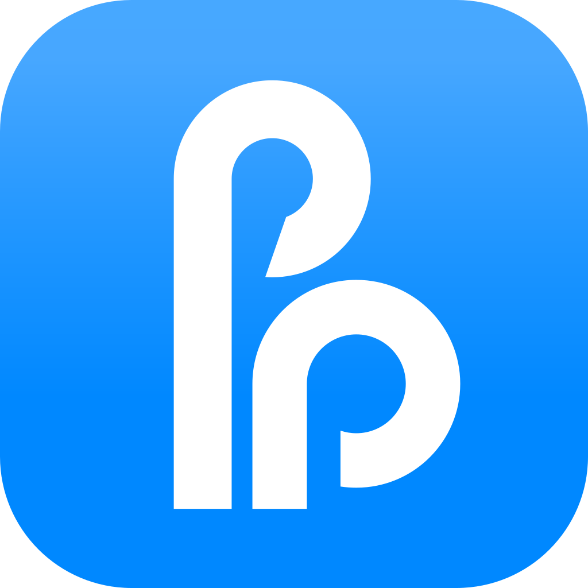
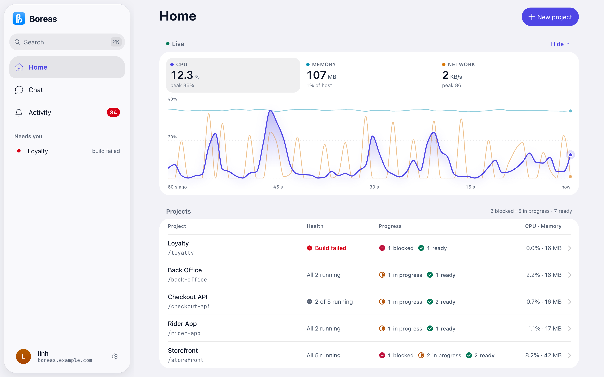
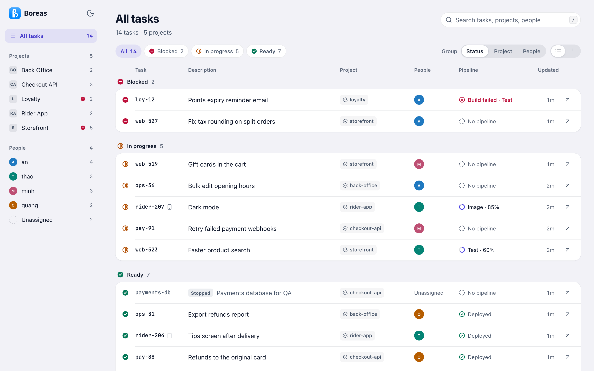
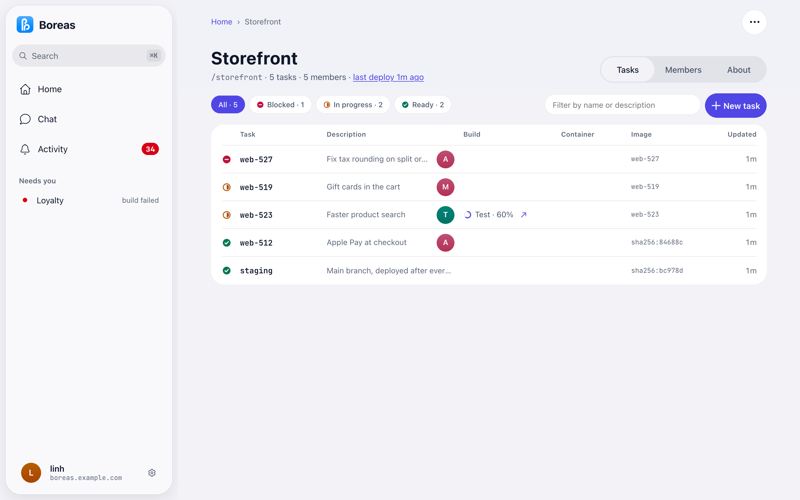
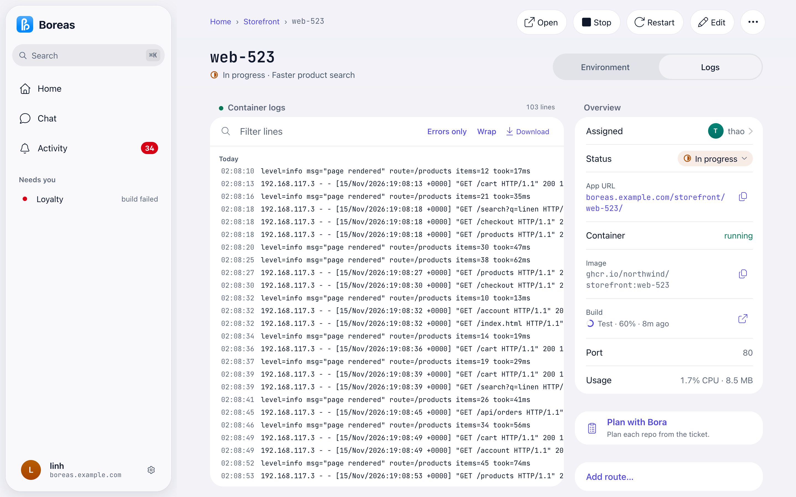
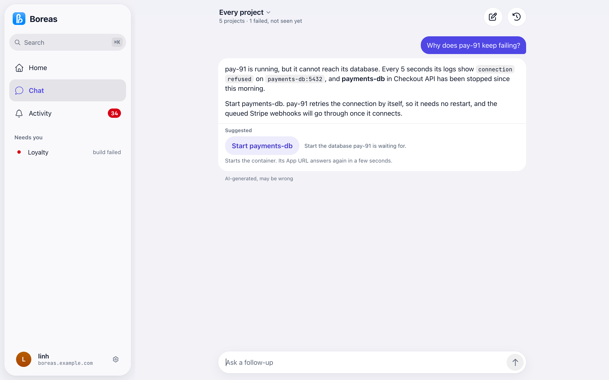
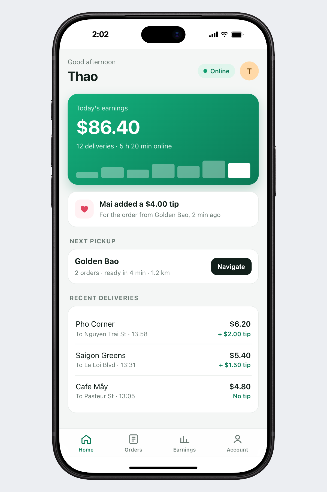
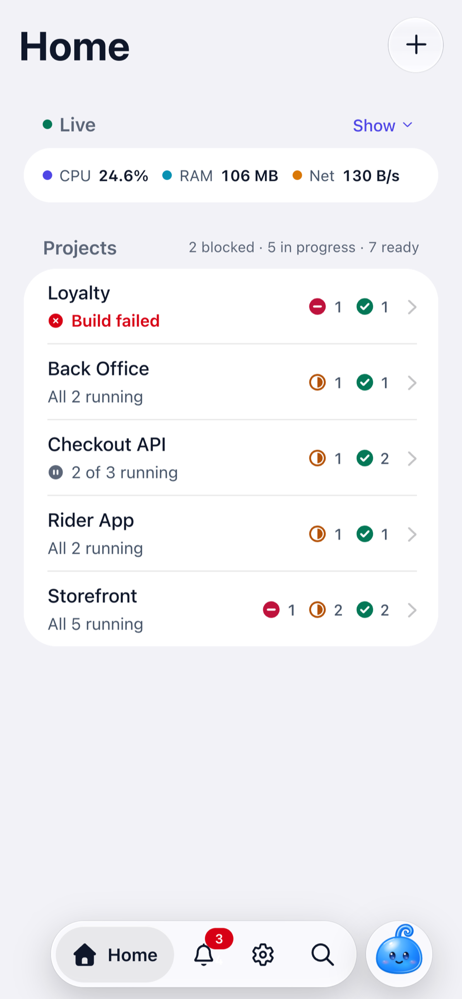

<div align="center">



# Boreas

**A separate test environment for every task.**

Boreas runs your app in a Docker container for each task, with a stable link that developers and testers can share.

[](https://github.com/zenkiet/boreas/releases)
[](go.mod)
[](https://github.com/zenkiet/boreas/actions/workflows/publish.yml)
[](https://github.com/zenkiet/boreas/pkgs/container/boreas)
[](LICENSE)


[Live directory](https://boreas.zenkiet.dev) · [Documentation](docs/README.md) · [Releases](https://github.com/zenkiet/boreas/releases) · [API reference](https://boreas.zenkiet.dev/api/v1/docs)

</div>

<picture>
  <source media="(prefers-color-scheme: dark)" srcset="docs/assets/screenshots/hero-dark.png">
  <source media="(prefers-color-scheme: light)" srcset="docs/assets/screenshots/hero-light.png">
  
</picture>

## Why Boreas

On a shared staging server, deploying one change can replace another team's
work. Testers lose the build they were checking, and everyone has to ask which
version is running.

Boreas keeps those environments separate. A checkout fix and a new search page
can run at the same time, each with its own link, assignees and testing status.

## How it works

1. Create a **project** for your product and a **task** for a change, such as `wo-718`.
2. Your CI pipeline builds and publishes a Docker image: the packaged app.
3. The pipeline asks Boreas to deploy that image to the task.
4. Testers open `https://your-server/shop/wo-718/`. Later deploys use the same link.

Each task runs one container. CI deploys identify an image by its **digest**, a
fingerprint of the exact build, rather than a tag that could change.

Boreas runs images; it does not build them or automatically watch branches.
Apps must support being served under a path such as `/shop/wo-718/`.

## Features

- **Separate task links:** test several changes without replacing each other's builds.
- **Build visibility:** see the deployed commit, pipeline progress, logs and live resource use.
- **Testing status:** mark work as in progress, blocked or ready, and show who is responsible.
- **Team access:** project roles and individual task grants control management permissions.
- **Notifications:** follow activity in the app, team chat or push notifications.
- **Bora, an optional AI assistant:** ask about tasks, logs and code, or draft a ticket plan. Changes require your approval.
- **Preview options:** password-protect a link or display a mobile web app in a phone frame.

**Public by default:** anyone who can reach the server can browse the task
directory and open unlocked task links. Management roles do not protect those
links. Containers share a Docker network and web origin; this is a staging
tool for trusted apps, not a sandbox for untrusted code.

Use Boreas from the team app on the web, iOS and Android, from an Amazfit watch
with the [Zepp OS companion](https://github.com/zenkiet/boreas-zeppOS), or
through the [API](docs/api.md).

## Screenshots

<table>
  <tr>
    <td width="50%">
      
      <br><sub>The public directory: every task, who is on it, and what is ready</sub>
    </td>
    <td width="50%">
      
      <br><sub>One project's tasks in the app</sub>
    </td>
  </tr>
  <tr>
    <td width="50%">
      
      <br><sub>A task: its status, build and logs</sub>
    </td>
    <td width="50%">
      
      <br><sub>Bora answering a question</sub>
    </td>
  </tr>
  <tr>
    <td width="50%">
      
      <br><sub>A mobile task on a desktop, inside an iPhone frame</sub>
    </td>
    <td width="50%" align="center">
      
      <br><sub>The app on a phone</sub>
    </td>
  </tr>
</table>


## Quick start

You need Docker Engine with the Compose plugin. Replace `change-me` with your
own administrator password, at least 8 characters:

```bash
git clone https://github.com/zenkiet/boreas.git && cd boreas
BOREAS_ADMIN_PASSWORD=change-me docker compose up --build -d
```

Open <http://localhost:8080> for the public directory or
<http://localhost:8080/api/v1/docs> for the API. The first administrator is
`admin`, with the password you set. Follow [Get started](docs/getting-started.md)
to sign in and create a working example.

Compose starts Boreas, PostgreSQL and the notification service. Use a staging
machine: Boreas has access to its Docker socket. Before exposing it, set strong
database credentials and configure [HTTPS](docs/configuration.md#behind-a-reverse-proxy-with-https).

The web/iOS/Android team app shown above is a separate project; it is not
included in this server's directory page.

## Documentation

- [Get started](docs/getting-started.md): install, sign in, and run a first task
- [Projects and people](docs/projects-and-people.md): accounts, roles, task grants and assignees
- [Work with tasks](docs/tasks.md): statuses, settings, shared folders, mobile apps and locks
- [Deploy from your pipeline](docs/deploy-from-ci.md): tokens, deploys by digest and build progress
- [Bora](docs/bora.md): what the assistant can answer and change
- [Notifications](docs/notifications.md): the feed, Slack or ntfy, and push
- [Configuration](docs/configuration.md): every setting with its default
- [API](docs/api.md): authentication, live streams and the generated reference

## Development

Boreas is a Go server that embeds a SvelteKit directory page.
[Development](docs/development.md) covers building and testing it, and
[AGENTS.md](AGENTS.md) holds the repository's conventions.

## License

[MIT](LICENSE)
